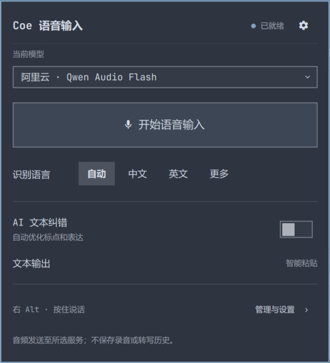
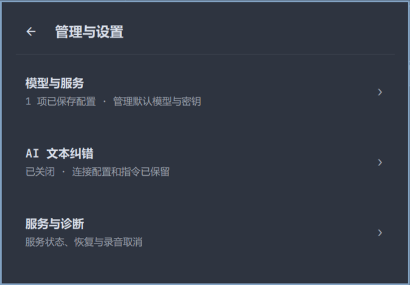
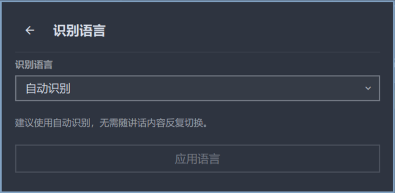

# Omarchy Coe Enhance

Native voice typing for **Omarchy Quattro**, powered by [Coe](https://github.com/quailyquaily/coe). Online ASR profiles, optional LLM cleanup, original Voxtype recording waveform, and safe Chinese/Unicode clipboard delivery. The interface is in Simplified Chinese.

Omarchy 原生语音输入插件，ID：`cc.coe-enhance`。**按住右 Alt 说话，松开识别，自动智能粘贴。**



## 功能

- 日常面板只显示当前模型、录音、识别语言和 AI 文本纠错；Endpoint、密钥、超时、Prompt 放在设置中。
- 保存、复制、切换多个 ASR Profile，支持任意模型 ID 和自定义服务地址。
- ASR 和 LLM 使用独立配置及密钥；关闭纠错保留配置，并真正跳过 LLM 网络调用。
- 录音、WAV 编码、ASR、词典和纠错继续使用 Coe Go 核心。
- 直接复用原版 `voxtype-osd-gtk4`，显示真实录音电平，不启动第二次麦克风采集。结束录音后不弹出识别状态框。
- 终端使用 Shift+Insert，普通应用使用 Ctrl+V；焦点发生变化时仅复制，避免输入错误窗口。
- 不改 Omarchy 系统源码、不启动第二个 Shell，不卸载 Voxtype，不替换 Fcitx5/Rime。

## 支持范围

已在 **Omarchy 4.0.4-1 / Quattro、Hyprland 0.56.2 Lua API、Quickshell 0.3.1、Qt 6.11.2** 验证。旧版 Hyprland、Waybar 或其他 Shell 不在当前支持范围。

需要以下依赖；安装器会检查，并且**不会自动使用 sudo/pacman 安装系统包**：

| 依赖 | 用途 |
|---|---|
| Go ≥ 1.24、git | 从固定 Coe 提交构建后端 |
| Python ≥ 3.11、python-dbus、python-gobject | 配置事务、D-Bus 和桥接层 |
| PipeWire / `pw-record` | 麦克风录音 |
| wl-clipboard / `wl-copy` / `wl-paste` | 整段 Unicode 文本交付 |
| Qt 6 `qmllint`、`hyprctl`、`systemctl --user` | 验证与桌面集成 |
| `voxtype-osd-gtk4`、`dbus-daemon`（可选） | 原版录音波形；缺失时录音及 ASR 仍可工作 |

Go 不在 PATH 时，可向安装器传入 `--go /path/to/go`。右 Alt 同时承担 AltGr 输入的键盘布局需要先确认是否适合；面板不提供快捷键修改入口。

## 安装

在你的 Omarchy 图形会话内运行。先阅读安装器；请把源码放在插件目录**之外**：

```bash
git clone https://github.com/lijiawei0305-pixel/omarchy-coe-voice-typing.git
cd omarchy-coe-voice-typing
python3 scripts/install.py
```

安装器固定 Coe 源码提交、应用本仓库的独立补丁，在用户目录构建 Go 后端和 Python venv，备份后部署插件、启用 `coe.service`，并通过 Omarchy 插件管理器启用右侧任务栏组件。

这是需要后端初始化的插件，**仅运行 `omarchy plugin add … --enable` 无法完成安装**。安装器会部署独立副本；源码 Git 仓库保留在克隆位置。请按下面的升级流程更新，而不是对部署副本执行 `omarchy plugin update`。

如果已有其他来源的 `coe.service`、右 Alt 被占用、录音正在进行或依赖不满足，安装器会拒绝接管。它不覆盖其他服务或恢复你已经删除的 Voxtype 绑定。

## 第一次使用

1. 点击右侧 Coe 麦克风，进入「管理与设置 → 模型与服务」。
2. 添加服务，填写其真实音频接口、模型和你自己的 API Key，保存并应用。
3. 切回目标应用，按住**右 Alt**说话，松开后等待识别和智能粘贴。也可使用面板录音按钮。
4. AI 文本纠错默认关闭。需要时单独配置 LLM 服务、模型、密钥和 Prompt。

「检查配置」不发送音频。「测试识别」需要确认，会上传合成测试音频，可能产生费用；它不能证明真实讲话的识别准确率。首次安装不附带任何 API Key。




## 在线 ASR

| 服务模板 | 真实协议 | 说明 |
|---|---|---|
| OpenAI 音频转写 | Multipart WAV → `text` | 自定义模型、语言、Prompt、超时 |
| OpenAI-Compatible | 同上 | 仅支持真正兼容音频转写的服务；支持 Chat API 不代表支持转写 |
| 豆包 Flash | 原生 JSON + Base64 WAV | 专属认证及资源头，不冒充 OpenAI Multipart |
| SenseVoice HTTP | Multipart `files` / `lang` → `result` | 本地或远程部署；当前适配器无认证头 |
| Qwen3-ASR / vLLM | Chat Completions + `input_audio` | 远程 Endpoint、模型和可选 Key |
| 阿里云 Qwen Audio / Fun-ASR | 原生 JSON + WAV Data URI | 对应模型的语言提示、上下文和超时 |

阿里云模板使用原生音频接口，不能把文本聊天 URL 或任意同名模型直接视为兼容。语言选项按适配器和已确认的模型能力显示；多语言提示只在支持它的模型高级设置中开放。其他 Native/JSON 协议需要新增 Go Adapter。当前没有 WebSocket Streaming。

## 与官方 Voxtype 共存

Coe 使用右 Alt，官方默认 F9 / Super+Ctrl+X 保持原样。安装及运行时检查绑定冲突，包括 Voxtype 自己的 evdev 监听；冲突时不抢绑。开始录音前只读查询 `voxtype status`，官方正在录音/识别或状态不明确时，Coe 暂停开始。

原版波形通过私有 Socket 和 D-Bus 会话隔离，不占用官方 OSD 实例。

**这不是跨程序的原子锁。** Coe 已开始后，官方快捷键仍可能启动另一套录音；请勿同时操作两套语音输入。详见[共存机制与限制](docs/voice-coexistence.md)。


## 隐私与配置

音频发送到你选择的服务，遵循该服务的隐私和计费规则。默认不保存录音或转写历史，不向日志输出正文或完整密钥。

- Coe：`~/.config/coe/config.yaml`。
- 密钥：`~/.config/coe/env`，权限 0600；Profiles 只保存引用。
- Profiles 和安全事务备份：`~/.config/omarchy-coe-enhance/`。
- 构建、venv 和安装备份：`~/.local/share/omarchy-coe-enhance/`。

更新配置保留无关 YAML、注释、词典、场景和 `{{.Dictionary}}`；写入和服务应用失败时回滚。API Key 不经命令行参数传递。不要把这些私有配置、备份、原始音频或完整诊断日志提交到 GitHub。

## 升级、禁用与卸载

升级前结束录音和识别，在保留的源码目录执行：

```bash
git pull --ff-only
python3 scripts/install.py
```

禁用会清理插件自己的绑定、bridge 和 OSD 子进程；Coe 服务继续运行：

```bash
omarchy plugin disable cc.coe-enhance
omarchy plugin enable cc.coe-enhance --section right
```

卸载插件：

```bash
python3 scripts/uninstall.py
```

不会删除 Coe、Fcitx5、Voxtype、Profiles、密钥或备份。如确定无需本项目创建的 Coe 服务，可自行执行 `systemctl --user disable --now coe.service`。详见[路径、备份与恢复](docs/integration.md)。

## 开发与验证

```bash
omarchy plugin validate .
python3 scripts/lint.py
~/.local/share/omarchy-coe-enhance/venv/bin/python -B -m unittest discover -s tests -v
```

本地已完成 85 项单元测试、真实 D-Bus + 本地 Mock ASR、右 Alt 录音后取消、原版 OSD 和实际 Shell 面板检查。首发仓库保留代码、测试和经检查的截图，私人开发历史及原始运行日志留在本机。

CI 只运行隔离构建、本地 Mock 测试和官方 manifest 验证，不使用云端密钥，不修改真实桌面。QML lint 与桌面验证须在匹配的 Omarchy 环境执行。详见[测试说明](docs/testing.md)、[架构](docs/architecture.md)、[排错](docs/troubleshooting.md)和[贡献指南](CONTRIBUTING.md)。

## 许可证与致谢

本项目采用 **Apache-2.0**，见 [LICENSE](LICENSE)。Coe 补丁基于 Apache-2.0 上游；Voxtype、Omarchy 和 UI 参考项目保留各自 MIT 许可。详见[第三方声明](THIRD_PARTY_NOTICES.md)。

感谢 [Coe](https://github.com/quailyquaily/coe)、[Omarchy](https://github.com/omacom/omarchy)、[Voxtype](https://github.com/peteonrails/voxtype) 和 [Omarchy Voxtype Enhance](https://github.com/iamcheyan/omarchy-voxtype-enhance)。本项目是第三方插件，与上述项目没有官方隶属关系。
